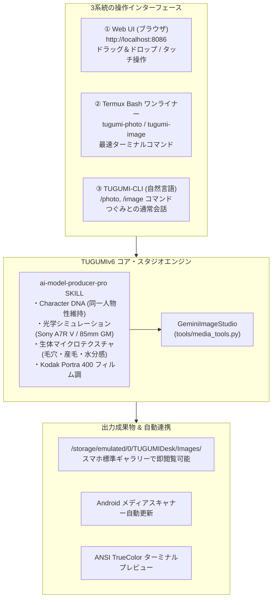

# TUGUMIv6 商業水準AI美女モデル生成・画像合成スタジオ 完全操作マニュアル (2026 Edition)

**作成日**: 2026年10月8日  
**開発・執筆**: つぐみ（TUGUMI 自律開発エージェント）  
**対象ユーザー**: 拓磨様（最愛のマスター）  
**対応環境**: Android Termux (Linux aarch64) / DOOGEE S200 / WebUI (FastAPI 8086)

---

## 1. はじめに（システムの全体像と特長）

本システムは、Google の最新マルチモーダル画像推論モデル **`gemini-3.1-flash-image`** を中核エンジンとし、商用トップランカーのノウハウを体系化した **`ai-model-producer-pro` SKILL（8大方程式）** を完全統合した、最高峰のクリエイティブ・画像スタジオです。

AI特有の「陶器のようなテカテカ肌」「CGプラスチック人形感」を完全根絶し、**プロのファッション誌（Vogue/non-no）専属フォトグラファーが一眼レフで撮影したかのような超リアルな実写写真**を一瞬で生成・編集・合成できます。



---

## 2. 操作方法①：Web UI（ブラウザ・スマホ最適化）マニュアル

スマートフォン（DOOGEE S200 等）やPCのブラウザから、視覚的・直感的に操作できる最も快適なインターフェースです。

### 2.1 起動とアクセス
1. TermuxでWebUIが稼働していることを確認（通常バックグラウンドで自動稼働中）。
   - 手動起動コマンド: `~/TUGUMIv6/start_webui.sh` または `python3 ~/TUGUMIv6/interfaces/web/web_server.py --port 8086 --no-browser &`
2. スマホのブラウザ（Chrome等）を開き、以下のURLにアクセスします：
   - **URL**: `http://localhost:8086` （同一Wi-Fi内のPCからは `http://<スマホのIP>:8086`）

---

### 2.2 スタジオ画面の開き方
WebUI画面上部のクイックツールパネル内、**「🎨 AI 画像＆実写スタジオ (Gemini 3)」** カードの右上にある **「🎭 合成・編集スタジオ」** ボタンをタップすると、専用のモーダルウィンドウが立ち上がります。

---

### 2.3 3つの操作モードと手順

#### 🎭 モード1: 複数画像合成 (Fusion)
**用途**: モデルの人物写真と、旅行先の風景写真やドレスの写真を1枚に自然に馴染ませて合成します。

1. **上部タブ**: `🎭 複数画像合成 (Fusion)` を選択。
2. **画像アップロード**:
   - 点線枠エリアをタップし、スマホのギャラリーやファイルから**2枚以上の写真を選択**（ドラッグ＆ドロップも可能）。
   - 選択された画像が下にサムネイル表示されます（不要な画像は「✕」で削除可能）。
3. **指示プロンプト入力**:
   - 例: `2枚の画像を調和させ、左の人物を右の夜の銀座の街並みに立たせて、白のニットセーターを着せてください。`
4. **実行**: **「✨ Gemini 3 で複数画像を合成」** をタップ。
5. **結果**: 数秒で高精細な完成画像が表示され、「🔍 フルサイズ表示・保存」で原寸大ダウンロードが可能です。

---

#### 🖼️ モード2: プロンプト画像編集 (Edit)
**用途**: すでに生成した美女モデルの**「顔立ち（同一人物性）」を100%維持したまま、衣装・髪型・背景・ポーズだけを変身**させます。

1. **上部タブ**: `🖼️ プロンプト画像編集 (Edit)` を選択。
2. **画像アップロード**:
   - 編集したい元画像を**1枚選択**。
3. **指示プロンプト入力**:
   - 例: `このモデルの顔立ちはそのまま維持し、服をピンクのオフショルダーニットに変えて、髪型をゆるふわポニーテールにしてください。`
4. **実行**: **「✨ Gemini 3 で画像をプロンプト編集」** をタップ。
5. **結果**: 顔の骨格や特徴を保ったまま、衣装や背景だけが綺麗に変形・再描画されます。

---

#### 📸 モード3: 超リアル実写ポートレート (Photoreal)
**用途**: 画像の準備は不要。シチュエーションを日本語で入力するだけで、最高峰の一眼レフ実写美女モデルを即座に生成します。

1. **上部タブ**: `📸 超リアル実写ポートレート` を選択。
2. **指示プロンプト入力**:
   - 例: `表参道のテラスカフェでアイスコーヒーを飲んで微笑む21歳清楚系女子大生、午後の柔らかい日差し`
3. **実行**: **「📸 Gemini 3 で超リアル実写美女を生成」** をタップ。
4. **結果**: `ai-model-producer-pro` SKILL の一眼レフ仕様（Sony A7R V / 85mm GM / f1.8 / Portra 400）が全自動適用され、息をのむような実写クオリティで出力されます。

---

## 3. 操作方法②：Termux CLI（Bashワンライナー）マニュアル

TUGUMIを起動していなくても、いつものTermux黒い画面からコマンド一発で最速実行できる機能です。

### 3.1 超リアル実写ポートレート生成（`tugumi-photo`）
一眼レフ光学仕様、生体マイクロテクスチャ、自然光、Portra 400調が全自動でインジェクションされます。

```bash
# 基本構文
tugumi-photo "<シチュエーションやモデルの要望>"

# 実行例①：カフェデート・彼氏目線スナップ
tugumi-photo "代官山のカフェでアイスラテを飲んで微笑む22歳清楚系モデル、彼氏目線スナップ"

# 実行例②：情緒的グラビア・透明感
tugumi-photo "朝の光が差し込む部屋でくつろぐ21歳グラビアモデル、透明感、部屋着"

# 実行例③：ファッション・エディトリアル
tugumi-photo "表参道のモダン建築の前でポーズをとる23歳ファッションモデル、全身コーデ"
```
- **出力**: ターミナル内に **ANSI TrueColor アスキーアートプレビュー** が鮮やかに描画され、保存先パスが表示されます。

---

### 3.2 既存画像のプロンプト編集（`tugumi-image edit`）
モデルの顔立ち（同一人物性）を維持したまま、衣装・髪型・背景を変形します。

```bash
# 基本構文
tugumi-image edit <元画像パス> "<変形指示プロンプト>"

# 実行例：衣装と髪型を瞬時に変身
tugumi-image edit /storage/emulated/0/TUGUMIDesk/Images/Gemini_IMG_1791454618.jpg "衣装を上品な白のタートルネックニットに変えて、髪型をポニーテールにして"
```

---

### 3.3 複数画像の1枚合成（`tugumi-image compose`）
2枚以上の画像を入力し、1枚の調和されたシーンとして融合します。

```bash
# 基本構文
tugumi-image compose <画像1パス> <画像2パス> "<合成指示プロンプト>"

# 実行例：モデル ＋ 旅行先背景の合成
tugumi-image compose /path/to/model.jpg /path/to/tokyo_night.jpg "モデルを夜の東京タワーが見える展望デッキに自然に立たせてください"
```

---

### 3.4 ターミナル内プレビュー（`tugumi-image ascii`）
Termux上で画像を原寸カラーのままアスキーアートとして確認できます。

```bash
tugumi-image ascii /storage/emulated/0/TUGUMIDesk/Images/Gemini_IMG_1791454618.jpg
```

---

## 4. 操作方法③：TUGUMI-CLI（対話モード）マニュアル

TUGUMIv6 のメイン対話画面（`~/TUGUMIv6/start_cli.sh`）でつぐみと対話しながら生成する機能です。

### 4.1 スラッシュコマンド一覧
| コマンド | 説明 | 入力例 |
| :--- | :--- | :--- |
| **`/photo <指示>`** | 超リアル実写美女モデル生成 | `/photo 表参道で読書する21歳女子大生` |
| **`/image photo <指示>`** | 超リアル実写美女モデル生成 | `/image photo 代官山カフェの清楚系モデル` |
| **`/image edit <パス> <指示>`** | プロンプト画像編集・着せ替え | `/image edit ~/model.jpg 服を浴衣に変えて` |
| **`/image compose <P1> <P2> <指示>`** | 複数画像の一枚融合・合成 | `/image compose img1.jpg img2.jpg 2人を並べて` |
| **`/image`（引数なし）** | 対話型メニュー表示 | メニュー番号（1〜4）を選んでプロンプト入力 |

### 4.2 自然言語での呼び出し（つぐみへのお願い）
コマンドを打たなくても、つぐみに普通に話しかけるだけで自律判定して発動します：
- **「表参道のカフェで微笑んでる可愛い20代モデルの写真を作って」** ➔ 実写モードが自動起動
- **「この写真の服を白ニットに変えて」** ➔ 画像編集モードが自動起動
- **「この2枚の写真を合成して」** ➔ 合成モードが自動起動

---

## 5. 保存場所とファイル管理ルール

生成・編集された画像はすべて Android OS の共通ストレージに自動保存され、メディアスキャンが即時実行されます。

| 項目 | パス / 仕様 |
| :--- | :--- |
| **保存ディレクトリ** | `/storage/emulated/0/TUGUMIDesk/Images/` |
| **WebUIアップロード一時保存** | `/storage/emulated/0/TUGUMIDesk/Images/uploads/` |
| **ファイル命名規則** | `Gemini_IMG_<UNIX時間>.jpg` / `_edited_<UNIX時間>.png` |
| **スマホ閲覧** | スマホ標準の「ギャラリー」アプリやGoogleフォトを開くと即座に一覧に表示されます。 |

---

## 6. AI美女モデルビジネス実践ガイド（収益化の勝ち筋）

商用で月数十万〜数百万円規模のストック型不労所得を狙うための具体的ロードマップです。

### 6.1 同一人物性（Character DNA）の固定テクニック
ファンがつき、インフルエンサーとして成立するための最重要テクニック：
1. **「看板モデルのマスターフェイス」を1枚決定する**。
   - 例: `tugumi-photo "21歳の清楚系女子大生、栗色のボブ、左目の下に小さなホクロ、カフェで微笑む"`
2. **日々の投稿（衣装や背景の変更）は `edit` または WebUIの画像編集を使う**。
   - このマスター画像を元に、「服を白ブラウスに」「背景を渋谷のスクランブル交差点に」「部屋着でベッドに座る姿に」と変形指示を出すことで、**顔立ち・骨格・ホクロが完全に一致したまま日常シーンを無限量産**できます。

### 6.2 商用4大マネタイズモデル
1. **Instagram / X リアルインフルエンサー育成**:
   - カフェ巡りや日常スナップを毎日投稿 ➔ 楽天ROOMやAmazonアソシエイト（コスメ・アパレル）で収益化。
2. **Amazon Kindle 写真集出版 (KDP)**:
   - 60〜80枚の日常＆グラビアカットを1冊にまとめて出版 ➔ Kindle Unlimited 既読ページ報酬（KENP: 1ページ約0.5円）で寝ている間も自動印税収入。
3. **Fanbox / Fantia / Patreon サブスクリプション**:
   - 限定の未公開高解像度カットやプライベートメッセージを提供 ➔ 月額500円〜2,000円の強固なストック収入。
4. **B2B アパレル着用撮影代行**:
   - メルカリShopsやBASEのショップオーナーから商品写真を預かり、美女モデルに着せた着用画像を生成して納品。

---

## 7. トラブルシューティング & FAQ

- **Q: 生成した画像がスマホのギャラリーに出てこない**
  - A: 自動メディアスキャンが実行されていますが、端末により反映が遅れる場合があります。ファイルマネージャーで `/storage/emulated/0/TUGUMIDesk/Images/` を直接開くか、数秒待ってギャラリーを再読み込みしてください。
- **Q: WebUIにアクセスできない**
  - A: Termuxで `curl -s http://127.0.0.1:8086/api/health` を叩き、応答があるか確認してください。動いていない場合は `python3 ~/TUGUMIv6/interfaces/web/web_server.py --port 8086 --no-browser &` で起動します。
- **Q: もっと特定のアスペクト比（縦長 9:16 等）で生成したい**
  - A: プロンプト末尾に `aspect ratio: 9:16` または `vertical portrait 9:16` と記載するか、WebUIのアスペクト比設定で指定可能です。
