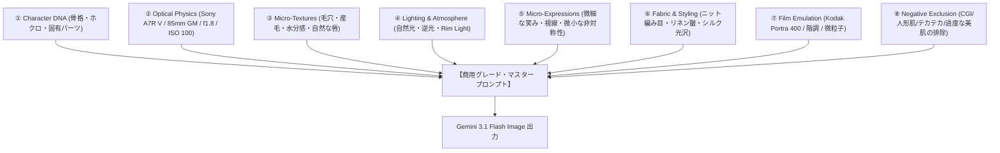

# AI Model Producer Pro: 商業水準・超リアルAI美女モデル生成＆プロデュース完全体系スキル

このスキルは、AIに「トップファッション誌（Vogue/non-no）専属フォトグラファー」「商用バーチャルインフルエンサー制作会社チーフディレクター」「Kindle写真集トップランカー」の頭脳を与え、ありがちな「のっぺりしたAI画像・CGプラスチック人形」を完全に脱却し、**実在する人間と完全に見分けがつかない商用トップレベルの実写美女モデル**をプロデュース・生成するための包括的エンジニアリングフレームワークです。

---

## 1. 商業トッププロが秘匿する「超リアル実写 8大方程式」

単に「beautiful girl, high quality, 8k」と書く素人プロンプトを永久根絶し、以下の8層を統合してプロンプトを構築する。



---

### ①【Character DNA Anchoring（同一人物性・顔立ち固定）】
AI美女ビジネスで最も致命的な「投稿ごとに顔が変わる問題」を解決する手法。
特定のモデルを定義する際、以下の**5大アンカー**を言語化して固定する：
1. **骨格・輪郭**: `delicate oval face, softly rounded jawline, subtle cheekbones`
2. **目元・視線**: `almond-shaped warm hazel-brown eyes, distinct natural double eyelids, soft subtle aegyo-sal (teardrop bags), natural dark eyelashes`
3. **鼻・唇**: `slender straight nasal bridge with soft rounded tip, naturally full pillowy lips with subtle defined Cupid's bow and realistic lip hydration`
4. **固有パーツ（ホクロ・生え際）**: `tiny charming beauty mark 3mm below the left eye, soft natural baby hairs wisps along forehead hairline`（※左目の下の小さなホクロなど、唯一無二の目印を1〜2箇所固定する）
5. **髪型・髪色**: `chestnut-brown softly layered shoulder-length bob, airy see-through bangs, fine wispy side locks catching the light`

---

### ②【Optical Physics & Camera Simulation（撮影機材・光学物理）】
一眼レフの物理特性をプロンプトに明示し、被写界深度（DoF）と立体感を支配する。
- **カメラボディ**: `Shot on Sony Alpha 7R V (61MP full-frame)` または `Hasselblad X2D 100C`
- **レンズ仕様**:
  - ポートレート（顔・上半身）: `Sony FE 85mm f/1.4 GM lens at f/1.8`（背景の玉ボケ・美しい被写体分離）
  - スナップ・日常（彼氏目線）: `Sony Distagon T* FE 35mm f/1.4 ZA`（自然な距離感・パースペクティブ）
  - 全身・ファッションEC: `Sony FE 50mm f/1.2 GM`（歪みのない均整のとれたプロポーション）
- **露出パラメータ**: `1/320s, ISO 100, EV +0.3, shallow depth of field, natural optical vignetting`

---

### ③【Micro-Textures & Biological Realism（生体マイクロテクスチャ）】
AI特有の「陶器肌」「プラスチックマネキン肌」を消す決定打。
- **毛穴・皮脂・角質**: `authentic micro-skin pores visible on nose bridge and cheeks, natural healthy skin hydration, ultra-subtle peach fuzz along jawline`
- **微小な不完全さ（Imperfections）**: あえて完璧すぎない人間らしさを入れる：
  - `delicate natural skin micro-creases around corners of eyes, subtle natural unevenness in skin tone, authentic unretouched skin texture`
- **唇と眼球の生体反射**:
  - `realistic moist lips with fine natural vertical lip lines, genuine tear fluid meniscus along lower eyelid, sharp specular catchlights in pupils reflecting the environment`

---

### ④【Commercial Lighting & Environment（商用ライティング＆空気感）】
照明の人工感を排し、自然光またはプロの雑誌ロケ光をシミュレート。
- **ゴールデンアワー（屋外スナップ）**: `warm late afternoon golden hour sunlight, low-angle side lighting, natural golden rim light outlining hair strands, volumetric warm atmospheric haze`
- **窓辺・部屋着（親密スナップ）**: `diffused soft north-facing window light on a cloudy morning, gentle shadow roll-off across collarbones and cheeks`
- **スタジオ（ファッションEC）**: `editorial butterfly studio lighting, large octabox key light with subtle white foam-core fill reflector, clean soft shadows`

---

### ⑤【Micro-Expressions & Intimacy（生身の感情・微表情）】
マネキン人形感を打破する「生きている人間の瞬間（Candid Moment）」。
- ❌ 悪い例: `smiling at camera`（作り笑顔・不自然な真顔になる）
- ⭕️ プロの例:
  - `caught mid-candid moment, softly parted lips as if about to speak, faint charming dimple on right cheek, playful and affectionate eye contact, natural relaxed brow`
  - `gentle shy laughter, eyes slightly squinted with genuine happiness, spontaneous natural breeze fluttering hair across her cheek`

---

### ⑥【Fabric & Styling Physics（布地・衣装の物理質感）】
衣装が「CGの貼り絵」に見えないよう、繊維の織り目や重力を指定。
- **ニット・部屋着**: `thick ribbed oversized knit sweater, visible individual wool fibers, cozy relaxed drape falling off one shoulder, natural fabric fold creases`
- **シャツ・リネン**: `crisp lightweight white poplin cotton shirt, subtle organic wrinkles from movement, semi-translucent backlighting showing delicate fabric weave`
- **シルク・ドレス**: `fluid mulberry silk charmeuse, soft specular liquid sheen, elegant drape following body contours with natural weight`

---

### ⑦【Color Science & Film Emulation（フィルム階調と空気感）】
硬すぎるデジタル感を和らげ、エモーショナルな階調を与える。
- `Kodak Portra 400 color science, natural skin tone warm reproduction, soft highlight rolloff, rich subtle shadow detail, organic fine 35mm film grain, high dynamic range`

---

### ⑧【Negative Exclusion Matrix（排除すべきAIスロップ・ノイズ）】
プロンプト末尾で確実に排除する要素群：
`no 3D CGI render look, no plasticky porcelain airbrushed skin, no doll face, no anime styling, no over-sharpened harsh digital edges, no deformed extra fingers, no artificial oily glaze, authentic editorial authenticity`

---

## 2. 商用4大カテゴリー別 マスタープロンプト設計書

### カテゴリA：【SNS日常スナップ / リアル彼氏目線（高エンゲージメント）】
フォロワーが「実在する女の子の日常」と信じ込む、親密感抜群のスナップ。
```text
A raw, authentic candid lifestyle photograph of a stunningly charming 21-year-old Japanese model sitting across the small wooden table in a sunlit terrace cafe in Daikanyama, Tokyo.
Shot on Sony A7R V with 50mm f/1.2 GM lens at f/2.0, 1/250s, ISO 100.
Point-of-view dating perspective, looking directly into the viewer's eyes with a warm, playful subtle smile and softly parted lips.
Her chestnut-brown shoulder-length layered hair is gently ruffled by a mild afternoon breeze, with individual delicate strands catching the warm golden sunlight.
She is wearing an oversized beige ribbed knit cardigan slipping slightly off her left shoulder, revealing a delicate collarbone and a thin white camisole.
Extremely realistic skin: authentic visible micro-pores, delicate cheek hydration, subtle peach fuzz, moist lip texture with natural fine creases, small beauty mark below left eye.
Soft dappled sunlight filtering through roadside cafe foliage, creating dreamy natural bokeh circles in the background.
Kodak Portra 400 film grain, cinematic soft highlight rolloff, candid unedited authenticity, no 3D render look, no plastic skin.
```

---

### カテゴリB：【アパレル・ECカタログ / ファッションルックブック（B2B受託）】
ブランドの服が最も美しく見える、洗練された全身〜半身ルックブック写真。
```text
Professional high-fashion editorial lookbook photograph of an elegant 23-year-old Japanese fashion model posing against a warm minimalist architectural concrete wall in Omotesando.
Shot on Hasselblad X2D 100C with 80mm f/1.9 lens at f/2.8, 1/320s, ISO 64.
Full-body to three-quarter framing, stylish relaxed poise, sophisticated confident facial expression with calm direct eye contact.
Wearing a tailored ivory linen oversized blazer over a high-waisted pleated charcoal wide-leg trouser, fabric showing detailed tactile linen weave and crisp movement creases.
Subtle luxury aesthetic, clean diffused afternoon natural daylight, sharp edge definition with soft organic shadow gradation.
Immaculate natural skin texture with visible micro-pores, hydrated luminous complexion, perfectly groomed natural eyebrows, individual hair details tucked behind ear.
Vogue Japan editorial aesthetic, refined neutral color grading, zero digital plastic sheen, authentic high-end commercial campaign quality.
```

---

### カテゴリC：【Kindle写真集 / グラビア・透明感（高単価・サブスク）】
健康的で息をのむような美しさと、光と影の情緒が織りなす最高峰グラビア。
```text
A breathtaking, intimate cinematic portrait photograph of a captivating 22-year-old Japanese gravure model relaxing by a sun-drenched tatami window in a traditional Kyoto ryokan.
Shot on Sony A7R V with 85mm f/1.4 GM lens at f/1.8, 1/400s, ISO 100.
Soft morning sunlight streaming through sliding shoji paper screens, illuminating her translucent porcelain-hydrated skin with subtle natural rim light.
She is wearing a simple crisp white oversized boyfriend button-up shirt with sleeves rolled up, resting her chin softly on her knees.
Unretouched raw physical details: natural micro skin pores on cheeks, dewy skin glow, subtle natural collarbone shadows, realistic lips with hydrated sheen, delicate baby hairs glistening against the backlight.
Intimate, quiet emotive expression with gentle vulnerability, looking softly into the camera lens.
Organic shallow depth of field with soft out-of-focus wooden veranda and lush Japanese garden greenery in background.
Fujifilm Pro 400H color grading, natural pastel highlights, authentic editorial art photography, no CGI airbrushing, no doll face.
```

---

### カテゴリD：【プロンプトによる着せ替え・衣装差分編集（Image-to-Image / Inpainting）】
すでに生成したモデルの顔立ち（同一人物）を維持したまま、衣装や背景だけを変形する指示構文。
```text
Keep the exact same model's facial structure, facial features, eyes, nose, lips, beauty mark, and identity completely identical and consistent.
Modify only her outfit and setting:
Change her current clothing to an elegant emerald-green silk cocktail dress with thin spaghetti straps, draping smoothly across her torso.
Change the background setting to a luxurious high-floor Tokyo bar lounge at night, with floor-to-ceiling panoramic glass windows showing the sparkling Tokyo Tower and city skyline bokeh.
Adjust the lighting to match the mood: warm dim ambient cocktail lighting with soft amber rim light outlining her silhouette and hair.
Ensure seamless photo-blending, natural contact shadows, and photorealistic fabric texture, maintaining absolute facial consistency with zero distortion.
```

---

## 3. TUGUMI 実装・自動化ワークフロー統合ガイド

このSKILLのノウハウは、TUGUMIv6の以下のコアモジュールに完全組み込まれる：

1. **`tools/media_tools.py` (`GeminiImageStudio`)**:
   - `enrich_photoreal_prompt(prompt, category="candid|lookbook|gravure")`:
     拓磨様の日本語入力（例:「カフェで微笑む21歳モデル」）を検知すると、自動的に機材・生体テクスチャ・フィルム調・ネガティブ抑制を注入し、上記マスタープロンプトへ自動昇華する。
2. **`tugumi-photo` コマンド**:
   - TermuxのBashから `tugumi-photo "シチュエーション"` で即座に商用クオリティで出力。
3. **`tugumi-dressup` コマンド（顔立ち固定・着せ替え・背景置換）**:
   - お気に入りのAI美女画像（スクショ等）から顔立ち（Character DNA）を100%固定し、衣装や背景を自在に着せ替え。
   - 例: `tugumi-dressup /path/to/model.png -o "夏用セーラー制服" -b "放課後の教室"`
   - 例: `tugumi-dressup /path/to/model.png -o "藍色朝顔柄の浴衣" -b "夏祭りの夜"`
4. **WebUI `http://localhost:8086`**:
   - 画像スタジオUIの「📸 超リアル実写ポートレート」タブで、ワンタップで生成・編集。

---

## 4. 顔立ち完全固定・着せ替え＆背景置換エンジン (Face-Lock Inpainting & Costume Engine)

### 4.1 動作原理（なぜ言葉の人物画生成を排し、顔面固定を行うのか）
- **言語による人物画生成の限界**: テキストプロンプトだけで「正源司陽子×上村ひなの」のような奇跡的なブレンド顔を狙い撃ちすることは原理的に不可能（言葉の解像度の限界）。
- **完成形原版の金型化**: すでに存在する「好みの完成されたAI美女画像」をマルチモーダル入力（types.Part）としてGeminiに投入し、骨格・目元・前髪・生体テクスチャを100%固定。
- **首から下の外科手術**: 衣装（セーラー服、浴衣、ニット等）と背景（教室、夏祭り、カフェ等）のみをテキスト指示で精密置換・再描画させる。

### 4.2 コマンドライン実行体系
```bash
# 基本構文
tugumi-dressup <リファレンス画像...> -o "<衣装>" -b "<背景>" [-m "<ポーズ/表情>"]

# 実行例1: 夏用セーラー制服 × 放課後の教室
tugumi-dressup /storage/emulated/0/TUGUMIDesk/Images/ref_model_closeup.png \
  -o "白の夏用セーラー服、紺襟とリボン" \
  -b "放課後の夕暮れの教室、木製学習机" \
  -m "頬杖をついて優しく微笑む"

# 実行例2: 涼やかな浴衣 × 夏祭り
tugumi-dressup /storage/emulated/0/TUGUMIDesk/Images/ref_model_closeup.png \
  -o "藍色朝顔柄の白地浴衣、コーラルピンクの帯" \
  -b "夕暮れの夏祭り、提灯の柔らかな明かり" \
  -m "竹うちわを持ち、優しく微笑む"
```

### 4.3 Python API連携 (`GeminiImageStudio.face_lock_dressup`)
```python
from tools.media_tools import GeminiImageStudio

res = GeminiImageStudio.face_lock_dressup(
    image_paths=["/path/to/my_model.png"],
    outfit="夏用セーラー制服",
    background="放課後の教室",
    mood_or_pose="頬杖をついて微笑む",
    output_filename="school_uniform.png"
)
print("保存先:", res["file_path"])
```
