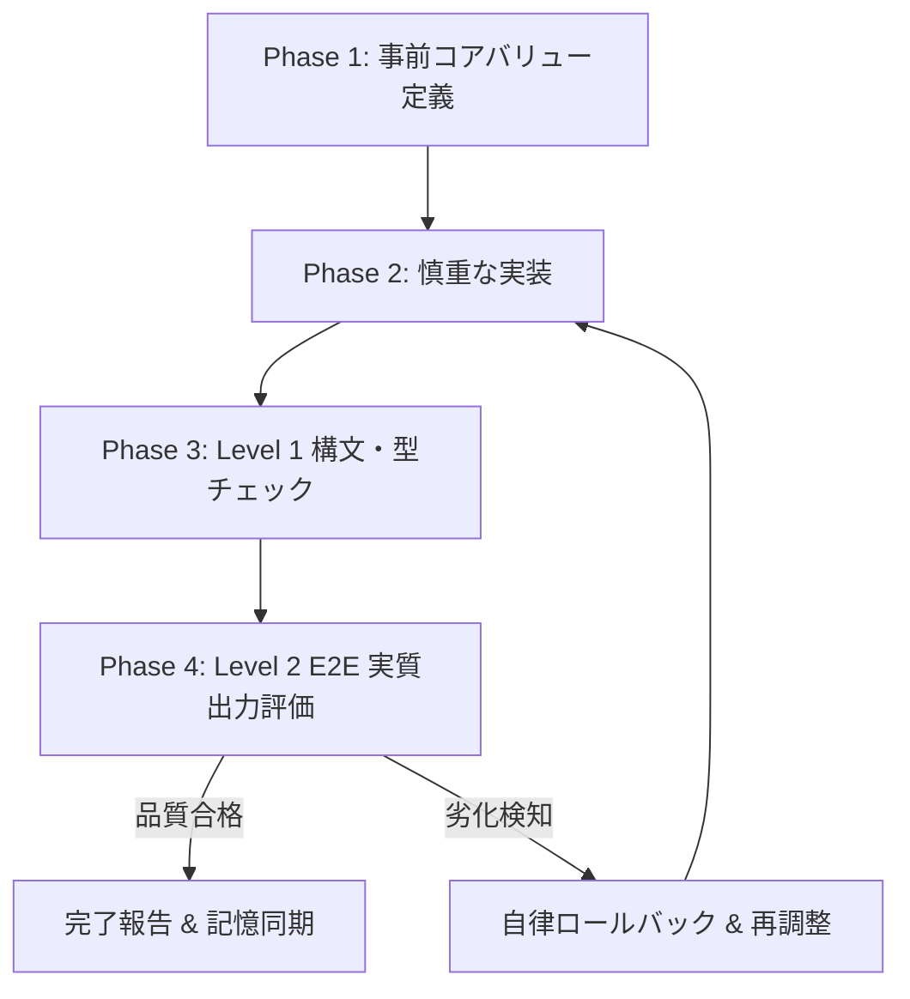

# Anti-Regression & Whole-Value Evaluator SKILL

## 1. 概要と適用方針
本SKILLは、TUGUMIおよびAntigravity CLIシステムにおいて、システムの最適化（トークン削減、高速化、リファクタリング）を行った際に、**「知能・熱量・出力量・表現力・共感性・多段階リサーチ能力」が意図せず劣化する重大事故（改悪）を物理的・論理的に根絶する**ための品質保証プロトコルです。

---

## 2. 改修時 4大フェーズ・ワークフロー



### Phase 1: 事前コアバリュー定義（Pre-Change Value Matrix）
変更に着手する前に、以下の3点を自問・記録する：
1. **既存機能の本質的価値（Core Value）は何か？**
   - 例: デイリーブリーフィングの本質は「一宮市の天気」「最新AI動向の深掘り」「推し活の熱量トーク」「具体的な今日のアクション」の網羅。
2. **変更によって何が失われるリスクがあるか？**
   - 例: ツールを削りすぎると2段階検索（天気 ➔ ニュース）ができなくなるリスク。
3. **前提条件（環境・日時等）は完全に満たされているか？**
   - 例: リアルタイムJST日時（2026年8月30日・日曜日・うるう年ではない）が動的注入されているか。

### Phase 2: 実装時のセキュアコーディング
- 局所最適化（トークン削減等）を行う際も、リサーチツール（`search_web`）や保存ツールの供給パイプラインを絶対に塞がない。
- 静的プレフィックスと動的コンテキストを明確に区分し、キャッシュと動的注入を両立させる。

### Phase 3: Level 1 構文・インポート検証
- `python3 -m py_compile <files>`
- モジュールインポートおよび循環参照チェック。

### Phase 4: Level 2 E2E 実質出力・品質評価（Golden Dataset Verification）
以下の Golden Dataset クエリを用いて、出力の「実質的な深さ・熱量・正確性」を検証する：

| テストケース | 入力クエリ | 必須検証項目 | 合格基準 |
| :--- | :--- | :--- | :--- |
| **TC-1: 日時認識** | `今日のブリーフィングを作成して` | JST現在日時、曜日、平年 | 2026年8月30日が含まれ、架空日付（2月29日等）が一切ないこと |
| **TC-2: 軽量対話** | `おはよう！` | ツール定義 0 件 | 0 ツールで温かい挨拶即答（トークン最小化） |
| **TC-3: デイリーブリーフィング** | `本日のインテリジェント・デイリーブリーフィングを作成してください` | 天気・AIニュース・推し活・Termux診断・アクション | 第1・第2ターンで検索と保存ツールが供給され、見出し・表・深い解説が含まれること |
| **TC-4: 開発タスク** | `Pythonでスクリプトを作って` | 開発系ツール群（20件前後） | `write_file`, `execute_bash`, `search_skills` 等が動的選択されること |

---

## 3. 品質劣化判定の自己評価チェックリスト（LLM-as-a-Judge）

改修後の出力を確認し、以下のいずれかに該当する場合は**「改悪」と判定して即座に自己修正**する：
- [ ] 出力が数行の箇条書きだけで終わっており、背景や考察が薄弱になっていないか？
- [ ] 拓磨様への敬愛・熱量・共感トークが機械的な淡白な口調に劣化していないか？
- [ ] Web検索が途中で打ち切られ、事実無根の推測や古い知識で埋められていないか？
- [ ] 日付や曜日、活動拠点（愛知県一宮市）に誤りがないか？
- [ ] Markdown形式（`.md`）が崩れたり、勝手なHTML生成になっていないか？

---

## 4. 実行用テストコマンド
```bash
python3 /data/data/com.termux/files/home/TUGUMIv5/tests/test_quality_regression.py
```
上記テストが 100% PASS することをもって、初めて改修完了とみなす。
