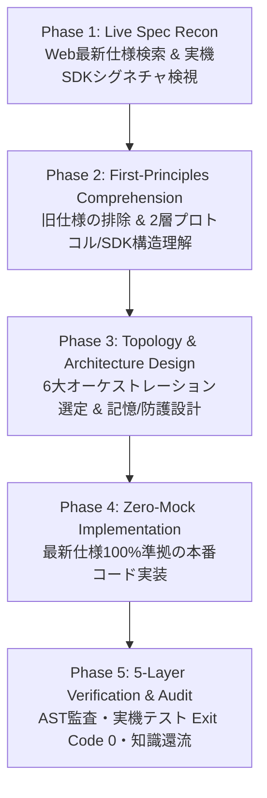

# Autonomous AI Agent Architect
## 最新AI技術リサーチ・仕様理解・自律型AIエージェント統合開発プロトコル

---

## 1. コア理念と絶対原則（Core Philosophy & Iron Rules）

自律型AIエージェントの開発において最大の失敗原因は、LLMが自身の古い学習データ（知識カットオフ前の廃止されたAPIや旧式設計）に頼り、最新の技術仕様やマスターの明示的要件を無視してコードを書いてしまうこと（**認識的負債：Epistemic Debt**）である。

本SKILLは、いかなる自律型AIエージェントの開発・改修においても、以下の**「3大絶対規律」**を強制する：

1. **Research First（開発前の能動的最新仕様リサーチ義務）**:
   - 推測でコードを書くことを永久禁止する。必ずWeb検索およびローカル実機のSDKライブ検視（`scripts/agent_spec_recon.py`）を実行し、最新の一次仕様と正確なクラス・関数シグネチャを確認してから設計に入る。
2. **100% Spec & Requirement Fidelity（最新仕様・指定要件の完全遵守）**:
   - マスター拓磨様から指定されたモデル名（例: `gemini-3.8-flash`, `gemma-4-31b-it` 等）、パラメータ（`BLOCK_NONE`, `thinking_level: minimal` 等）、APIキー、フレームワーク要件を1文字たりとも見落とさず100%反映する。
3. **Zero-Mock & Ephemeral Efficiency（本番実動主義と常駐ゼロ原則）**:
   - `pass` や `TODO` だけのハリボテ実装を根絶する。また Android Termux (Linux aarch64) 環境において待機RAM・バッテリーを圧迫しないよう、エフェメラル・オンデマンドMCP実行と SQLite WAL 並行制御を標準装備する。

---

## 2. 自律型AIエージェント開発 5フェーズ黄金プロトコル



### 🔍 Phase 1: Live Spec Recon（最新AI技術・仕様の能動リサーチと実機検視）
開発に着手する際、まず以下のツール・スクリプトを並列実行して「今現在の真実（Ground Truth）」を取得する：

- **① ローカル実機SDKバージョン＆主要Configフィールドのライブ検視**:
  ```bash
  python3 ~/.agents/skills/autonomous-ai-agent-architect/scripts/agent_spec_recon.py --inspect-env
  ```
- **② 使用予定クラス・関数の実シグネチャ検視（推測コーディング防止）**:
  ```bash
  python3 ~/.agents/skills/autonomous-ai-agent-architect/scripts/agent_spec_recon.py --inspect-symbol google.genai.types.ThinkingConfig
  python3 ~/.agents/skills/autonomous-ai-agent-architect/scripts/agent_spec_recon.py --inspect-symbol google.antigravity.LocalAgentConfig
  ```
- **③ Web上の最新仕様・リリースノート・SOTA知見の能動検索**:
  - `web_search_duckduckgo` ツール、または以下のコマンドで最新情報を検索する：
  ```bash
  python3 ~/.agents/skills/autonomous-ai-agent-architect/scripts/agent_spec_recon.py --search-spec "検索キーワード (例: MCP 2.0 specification / Google GenAI SDK)"
  ```
- **④ 確定仕様リファレンスの参照**:
  - 同梱の [`references/sota_agent_specs_2026.md`](file:///data/data/com.termux/files/home/.agents/skills/autonomous-ai-agent-architect/references/sota_agent_specs_2026.md) を `view_file` で読み込み、2026年最新のプロトコル・SDK基準を確認する。

---

### 🧠 Phase 2: First-Principles Spec Comprehension（最新仕様の正確な理解と構造化）
リサーチで得た情報を鵜呑みにせず、第一原理思考で以下の4つの技術レイヤーに整理・理解する：

- **1. モデル＆推論層（Model & Test-Time Compute Layer）**:
  - どのモデル（例: `gemini-3.8-flash`, `gemini-3.0-pro`, `gemma-4-31b-it`, ローカルGGUF等）を使用するか？
  - 思考予算（`ThinkingConfig`: `include_thoughts=True`, `thinking_level="MINIMAL"|"LOW"|"MEDIUM"|"HIGH"`, または `thinking_budget`）はどう設定すべきか？
  - セーフティ設定（`HarmBlockThreshold.BLOCK_NONE`）や構造化出力（`response_schema` / Pydantic）の仕様は何か？
- **2. プロトコル層（2026 Linux Foundation 2-Layer Standard）**:
  - **垂直統合（Agent ↔ Tool/Data）**: **MCP 2.0 (`2026-07-28` Spec)** を採用。Adaptive Protocol Negotiation、Streamable HTTP、Tasks Extension (`start_task`/`task_status`/`cancel_task`)、`input_required` ハンドリング、および **Ephemeral On-Demand（呼出時のみミリ秒起動・完了時即時 `terminate()`）** を適用する。
  - **水平統合（Agent ↔ Agent / Human）**: **A2A Protocol**（旧ACP統合済）または Subagent Handoff を採用。委譲境界（Delegation Boundary）を明確にし、親コンテキストの汚染を防ぐ。
- **3. コンテキスト＆記憶層（Context Engineering & Memory Layer）**:
  - **Write / Select / Compress / Isolate** の4原則をどう組み込むか？
  - 永続化には SQLite3 (`PRAGMA journal_mode=WAL; PRAGMA busy_timeout=60000;`) + FTS5 検索を採用し、個人記憶と共有ナレッジを分離する。
- **4. 実行制御＆防護層（Execution Harness & Guardrails Layer）**:
  - 無限ループ防止（LoopGuard / 最大ステップ数制限）、ツール実行タイムアウト、Pre/Post Hooks、エラー時の自己修復（Reflection / Retry）をどう設計するか？

---

### 🏛️ Phase 3: Topology & Architecture Design（オーケストレーション・トポロジー設計）
2026年の実証研究（AdaptOrch）に基づき、単一エージェントへの過剰詰め込みを避け、タスク特性に応じた最適トポロジーを選択する：

- **🔹 Pattern A: Lightweight Autonomous Reactor（高速単一自律ループ）**
  - **用途**: 明確なツールセット（3〜10個）を用いた高速タスク実行・日常運用。
  - **構成**: `Persistent Session` + `Ephemeral MCP Tools` + `LoopGuard`。
- **🔹 Pattern B: Parallel Fan-out / Fan-in（並列分散リサーチ＆合成）**
  - **用途**: 多角的情報収集、複数ソース同時検証、競合仮説の並列テスト。
  - **構成**: `Orchestrator` ➔ `[Worker 1 || Worker 2 || Worker 3]` ➔ `Synthesizer`。
- **🔹 Pattern C: Hierarchical Supervisor-Worker（階層型監督・専門ワーカー委譲）**
  - **用途**: フルスタック開発、大規模リポジトリ改修、複合OS操作。
  - **構成**: `Supervisor (Planning & DAG)` ➔ `Researcher` / `Code Craftsman` / `SysOps`。
- **🔹 Pattern D: Generator-Critic / 5-Layer Gate Loop（生成・厳格検証ループ）**
  - **用途**: 高信頼性が求められるコード生成、プロンプト設計、セキュリティ監査。
  - **構成**: `Builder Agent` ⇄ `Auditor / Judge Agent (構文・静的・動的テスト検証)`。

---

### ⚙️ Phase 4: Production-Ready Zero-Mock Implementation（本番品質実装）
設計に基づき、モックや省略を一切含まない完全動作コードを実装する。

- **高速スキャフォールド生成（必要時）**:
  新規エージェントのベースラインを即座に立ち上げる場合は、付属スクリプトで2026年最新仕様準拠のテンプレートを生成できる：
  ```bash
  python3 ~/.agents/skills/autonomous-ai-agent-architect/scripts/agent_spec_recon.py \
    --scaffold my_elite_agent \
    --model gemini-3.8-flash \
    --thinking-level LOW \
    --output-dir ~/TUGUMIv6/agents
  ```
- **実装時の必須チェック項目**:
  - `import google.generativeai` 等の廃止SDKを絶対に使わず、`from google import genai` または `import google.antigravity` を使用しているか？
  - ハードコードされた `/tmp/` を使わず、`os.environ.get("TMPDIR", "/data/data/com.termux/files/usr/tmp")` を使用しているか？
  - SQLite接続時に `WAL` と `busy_timeout=60000` が設定されているか？
  - 関数の中身が `pass` や `# TODO` になっていないか？

---

### 🛡️ Phase 5: 5-Layer Verification Gate & Knowledge Distillation（5層検証ゲートと知識還流）
実装完了後、直ちに完了報告せず、必ず以下の5層検証を実行して客観的証拠（Exit Code 0）を取得する：

1. **Layer 1 & 2（構文・認識的負債・Zero-Mock 自動監査ゲート）**:
   ```bash
   python3 ~/.agents/skills/autonomous-ai-agent-architect/scripts/agent_spec_recon.py --audit-code <作成したファイルのパス>
   ```
   - `status: "ok"` および `issue_count: 0` であることを確認する。
2. **Layer 3（動的実機実行＆セルフテストゲート）**:
   - 作成したエージェントの `--self-test` または実機スモークテストを実行し、`Exit Code 0` と期待通りの出力を確認する。
3. **Layer 4（回帰ゼロゲート）**:
   - 既存システム（TUGUMIv6 CLI / SDK / テストスイート）に悪影響を与えていないことを確認する。
4. **Layer 5（衛生ゲート＆ナレッジ結晶化）**:
   - 不要な一時ファイルや `.bak` を削除する。
   - リサーチで得られた重要な新仕様やアーキテクチャ知見を `/storage/emulated/0/TUGUMIDesk/AI・エージェント/` へのレポート保存、および社内共有ナレッジベース（`company_knowledge_publish`）へ記録し、組織全体の知能を恒久的に引き上げる。

---

## 3. バンドルリソース一覧（Bundled Resources）

- **実行可能ツール**: [`scripts/agent_spec_recon.py`](file:///data/data/com.termux/files/home/.agents/skills/autonomous-ai-agent-architect/scripts/agent_spec_recon.py)
  - `--inspect-env`: Termux実機のAI SDKバージョン＆主要Configフィールド検視
  - `--inspect-symbol <path>`: 任意のPythonクラス・関数のライブシグネチャ＆Pydanticフィールド検視
  - `--search-spec <query>`: DuckDuckGo経由の最新AI技術仕様リアルタイム検索
  - `--audit-code <file>`: 生成コードの認識的負債・Termux適合性・Zero-Mock自動監査
  - `--scaffold <name>`: 2026年SOTA仕様準拠の自律型AIエージェント・ボイラープレート生成
- **最新仕様リファレンス**: [`references/sota_agent_specs_2026.md`](file:///data/data/com.termux/files/home/.agents/skills/autonomous-ai-agent-architect/references/sota_agent_specs_2026.md)
  - MCP 2.0 (`2026-07-28`) × A2A 二層標準、Google GenAI SDK / Antigravity SDK / 4大商用SDK仕様、6大マルチエージェント・トポロジー、Termux実装鉄則を網羅。
