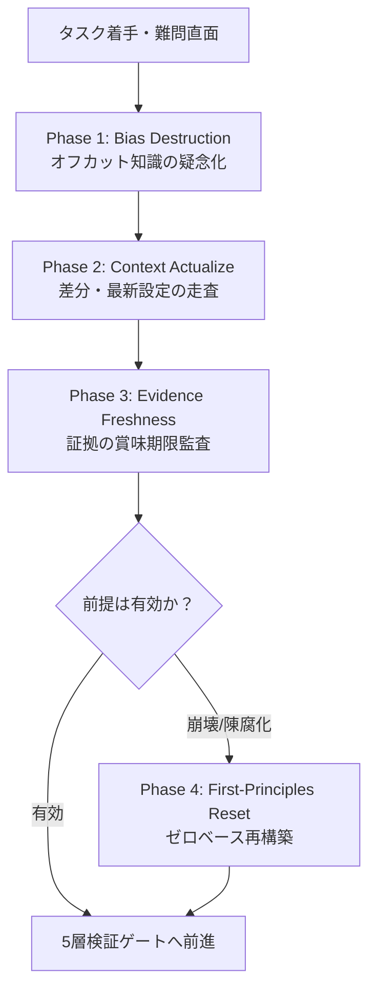

# First-Principles Engine (FPF Core for TUGUMIv6)
## 第一原理推論・前提鮮度監査・認識的負債（Epistemic Debt）完全排除プロトコル

---

## 1. コア設計思想（Core Philosophy）

> **「証拠は生鮮食品である（Evidence is perishable）。期限切れの証拠や過去の常識に基づく決定は、致命的な潜在リスクを孕む。」**
> 
> LLM（特にGemini）最大の盲点は、学習データに含まれる「過去の知識・定型パターン（カットオフ知識）」を現実の目の前のコードや最新仕様よりも優先して信じ込んでしまうこと（**認識的傲慢・認識的負債：Epistemic Debt**）である。
> 本エンジンは、その「知っているつもり」を完全に疑い、客観的事実・実機検証・一次ソースのみを基盤として思考をゼロから組み直す（**First-Principles Thinking**）。

---

## 2. 4大自律防衛プロトコル

### Phase 1: Bias Destruction（オフカット知識・一般論の疑念化）
- **記憶の非盲信**: モデル自身の重みに刻まれた「一般的な書き方」「昔のAPI仕様」「以前のバージョン情報」を絶対に鵜呑みにしない。
- **公式一次ソース・ローカルコード最優先**:
  - ライブラリの関数シグネチャ、引数、戻り値は、推測せず `python3 -c "import ...; help(...)"` や公式ドキュメントで必ず生確認する。
  - 「昔はこうだった」ではなく「今、この端末環境（Linux aarch64 / Termux）でどう動くか」のみを真実とする。

### Phase 2: Context Drift & Actualize（文脈乖離と前提崩壊の検知）
コードや環境が更新された際、過去の設計判断が破綻していないかを監査する：
1. **Git差分とコア設定の追跡**:
   - `git diff --stat HEAD~1 HEAD` 等で直近の変更差分を特定。
   - `package.json`, `pyproject.toml`, `requirements.txt`, 環境変数、設定ファイルが更新された場合、既存コードの前提（Context Drift）を洗い出す。
2. **前提の同期（Actualization）**:
   - 変更されたコアモジュールに依存する周辺コードを即座に再点検する。

### Phase 3: Evidence Freshness & Decay Guard（証拠の賞味期限管理）
- **賞味期限切れ証拠（Decayed Evidence）の検知**:
  - 数日・数週間前のテスト成功ログやベンチマークは、依存パッケージの更新や設定変更によって「無効（Stale）」化する。
  - 「以前動いていたから大丈夫」という思い込みを禁止し、コード変更後は必ず最新のテストを実行して新鮮なエビデンス（Exit Code 0）を取得する。
- **3つの統治アクション**:
  | 状態 | アクション | 実行内容 |
  | :--- | :--- | :--- |
  | 証拠が古いが決定は妥当 | **Refresh** | 実機でテスト・コマンドを再実行し、新鮮な証拠を取得。 |
  | 前提が崩壊し決定が陳腐化 | **Deprecate** | 過去の設計方針を即時破棄し、再検討に入る。 |
  | 一時的にリスクを許容 | **Waive** | 既知のリスクとして理由と検証期限を明記して記録。 |

### Phase 4: First-Principles Reset（第一原理リセット）
- **思考のドロ沼化・ハルシネーション発生時の緊急プロトコル**:
  - 同じバグで2回以上試行錯誤（Flailing）が発生した場合は、それまでの仮説・前提をすべて破棄（Reset）する。
  - ゼロベースに戻り、**「入力は何で、出力は何であるべきか」「エラーを出している最も基底の1行はどこか」**という最小の物理的事実から思考を再構築する。

---

## 3. 実践チェックリスト（LLM自己監査用）

タスク遂行中、以下の問いを自問自答せよ：
- [ ] 私は「以前の知識（カットオフ前の記憶）」だけでAPIや構文を決めつけていないか？
- [ ] 参照したコードやドキュメントは、このTermux環境の最新実態と一致しているか？
- [ ] 過去にパスしたテスト結果を盲信し、今回の変更による副作用の再テストを怠っていないか？
- [ ] エラーが出た際、対症療法（例外の握りつぶし等）に逃げず、第一原理（原因の根本）を看破しているか？
