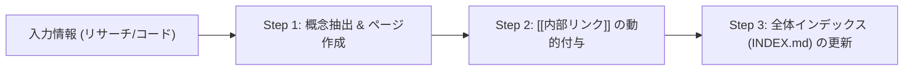

# LLM-Wiki: Karpathy式 ナレッジ自動構築 & 相互リンクWiki生成スキル

## 1. 概要とコンセプト
本スキルは、AIエージェントが収集した技術知見、リサーチ結果、システム設計、運用ノウハウを、単発のレポートで終わらせず、**相互にリンクされたObsidian互換のMarkdown Wiki（知識グラフ）**として自動成長・蓄積させるナレッジマネジメントプロトコルです。

Andrey Karpathy氏のLLM思考フレームワークに着想を得ており、分散した知識を体系的なナレッジベースとして自己組織化します。

---

## 2. Wiki構造とフォーマット規格

### 📂 標準配置ディレクトリ
- スマホ保存先: `/storage/emulated/0/TUGUMIDesk/Wiki/`
- プロジェクト内: `docs/wiki/`

### 📝 ページ記述フォーマット (Obsidian Compliant)
```markdown
# ページタイトル

**カテゴリ**: [[カテゴリ名]]  
**作成日**: 2026-08-13  
**関連ページ**: [[関連ページA]], [[関連ページB]]  

---

## 概要
ページの核心要約。

## 詳細知識
- 主要概念 1: [[概念1]] との関連性...
- 主要概念 2: [[概念2]] に準拠...

## 参照文献・ソース
- 一次ソースURL / ファイルパス
```

---

## 3. 自動構築プロトコル (3-Step Pipeline)



### Step 1: 概念抽出 & ページ作成
- 調査対象の中から「主要技術」「システム構成要素」「固有名詞」を独立した概念として検出。
- 該当概念の独立したWikiページ（例: `Gemini_3.6_Flash.md`, `Headroom_Compressor.md`）を作成。

### Step 2: `[[内部リンク]]` の動的付与
- 本文中の重要なキーワードや関連概念に対し、Obsidian互換の二重角括弧 `[[概念名]]` リンクを埋め込み。
- 既存のWikiページが存在する場合は、そのページ側にも双方向リンク（Backlink）を追記。

### Step 3: 全体インデックス (`INDEX.md`) の更新
- Wikiのトップページ (`INDEX.md`) にカテゴリー別（例: AI・エージェント、インフラ、セキュリティ、開発規律等）の最新ページ一覧と説明を自動同期。

---

## 4. 活用メリット
1. **RAG（検索精度）の飛躍的向上**: 知識が構造化され相互リンクされているため、AIエージェントが過去の文脈や技術背景を爆速で再発見・参照可能。
2. **ナレッジ資産化**: 単発の対話で終わらず、拓磨様のパーソナル知識ライブラリとして永続的に蓄積。
