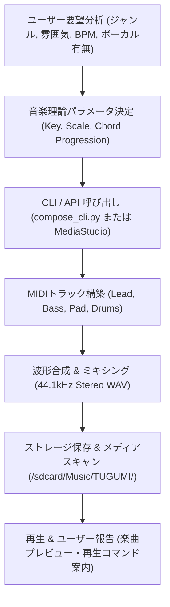

# music-composer-pro: TUGUMIv6 プロフェッショナル音楽制作・自律作曲スキル

## 1. スキル概要 (Overview)
`music-composer-pro` は、Android Termux (Linux aarch64) 環境および Antigravity / TUGUMIv6 システムにおいて、高度な音楽理論と波形合成技術を融合し、完全オリジナルの楽曲・BGM・ボーカル曲を作曲・編曲・レンダリング・再生するプロフェッショナル音楽制作スキルです。

### 主な能力と特徴
1. **音楽理論準拠の自動作曲**:
   - 王道進行 (IV-V-iii-vi)、丸サ進行 (Just The Two of Us)、小室進行、カノン進行、サイバーシンセ進行など、ジャンルや感情に合わせた黄金コード進行を自動適用。
   - メジャー、マイナー、ドリアン、リディアン、平調子（和風）などのスケール展開とボイシング。
2. **ゼロ外部依存・ローカル高音質レンダリング**:
   - `PureMidiWriter`: 外部Cライブラリや重いツール不要の純粋Python MIDIエンコーダ。
   - `WaveSynthesizer`: NumPyを活用した44.1kHz Stereo リアルタイム伴奏合成（FM変調、ノコギリ波、サイン波、キック・スネアドラム合成、ADSRエンベロープ）。
3. **Google DeepMind Lyria / Gemini Native Audio 連携**:
   - クラウドAPI利用可能な場合は、Geminiのネイティブオーディオモデルおよび歌唱合成（Aoede, Puck等）によるプロクオリティのボーカル曲生成。
4. **Android / Termux 最適化**:
   - 生成したオーディオを `/storage/emulated/0/Music/TUGUMI/` へ自動ミラー配置し、Androidのメディアスキャンを発行。
   - `termux-media-player` または `termux-open` による即時BGM再生。

---

## 2. トリガー条件 (Trigger Conditions)
以下のようなユーザーの意図を検知した際に、本スキルを最優先で適用します：
- 「曲を作って」「音楽を作って」「BGMを作って」「作曲して」「楽曲を制作して」
- 「Lo-Fiのチルな曲を作って」「サイバーパンクなシンセウェーブを作って」
- 「作業用の落ち着いたピアノBGMを作って」「疾走感のあるJ-POPを作って」
- 「MIDIファイルを生成して」「ボーカル付きの歌を作って」

---

## 3. 実行ワークフロー (Execution Workflow)



### ステップ 1: パラメータの特定
ユーザーのリクエストから以下の要素を抽出・決定します（指定がない場合は最適なデフォルトを採用）：
- **タイトル**: 英語/ローマ字または日本語のスラッグ
- **ジャンル**: `lofi`, `synthwave`, `jpop`, `cyberpunk`, `edm`, `ambient`, `piano_solo`
- **BPM**: テンポ (Lo-Fiなら82, Synthwaveなら120, J-POPなら134等)
- **キー**: C, Eb, F, A, D等
- **小節数**: デフォルト8小節 (短尺プレビューなら4〜8小節、フル展開なら16〜32小節)
- **ボーカル**: あり / なし (歌詞テキスト)

### ステップ 2: 楽曲生成コマンドの実行
Termuxターミナルまたはサブプロセスから `scripts/compose_cli.py` を呼び出します。

#### コマンド実行例:
```bash
# 1. サイバーパンク・シンセウェーブ曲の生成と即時再生
python3 ~/.agents/skills/music-composer-pro/scripts/compose_cli.py \
  --title "Neon_Odyssey" \
  --genre "synthwave" \
  --play

# 2. チルなLo-Fi HipHop (丸サ進行) の生成
python3 ~/.agents/skills/music-composer-pro/scripts/compose_cli.py \
  --title "Midnight_Rain" \
  --genre "lofi" \
  --bars 12

# 3. ボーカル付きJ-POPソングの生成
python3 ~/.agents/skills/music-composer-pro/scripts/compose_cli.py \
  --title "Hikari_no_Tsubasa" \
  --genre "jpop" \
  --vocal \
  --lyrics "夜明けの空を見上げて、僕らは進むよ。つぐみの歌声が拓磨様に届くまで。"
```

### ステップ 3: 再生とコントロール
```bash
# 生成楽曲の一覧表示
python3 ~/.agents/skills/music-composer-pro/scripts/termux_player.py list

# 最新トラックの再生
python3 ~/.agents/skills/music-composer-pro/scripts/termux_player.py play 1

# 再生停止
python3 ~/.agents/skills/music-composer-pro/scripts/termux_player.py stop
```

---

## 4. ジャンル別推奨構成早引き表

| ジャンル | BPM | スケール/キー | コード進行 | 音色構成 |
| :--- | :---: | :--- | :--- | :--- |
| **Lo-Fi** | 80-84 | Eb Major | 丸サ進行 (`IVM7 - III7 - vim7 - I7`) | Rhodesエレピ, Warm Pad, 指弾きベース |
| **Synthwave** | 118-124 | A Minor | サイバーシンセ (`im - VI - III - VII`) | Sawリード, レトロシンセパッド, アシッドベース |
| **J-POP** | 130-136 | F Major | 王道進行 (`IVM7 - V7 - iiim7 - vim7`) | 明るいリード, ストリングス, ピックベース |
| **Cyberpunk** | 126-130 | D Minor | ディストピア進行 (`im - VI - iv - V`) | Charang, 金属音リード, スラブベース |
| **Ambient** | 60-70 | C Major / Lydian | 浮遊進行 (`Imaj7 - IVmaj7`) | ビブラフォン, コア合唱パッド, ベル |
| **Piano Solo** | 72-80 | C Major | カノン進行 (`I - V - vi - iii - IV - I - IV - V`) | アコースティック・グランドピアノ |
| **【拓磨様最愛】坂道系エモアイドル (乃木坂46/日向坂46風)** | 136 | E Major | 王道・カノン進行 (`IV - V - iii - vi`) | 繊細なグランドピアノ, アコースティックギター, 疾走ストリングス, ピュア女性ユニゾン |
| **【拓磨様黄金指針】PANDORA / Be The One** | 128 | F# Minor | 小室・哀愁EDM進行 (`vim - IV - V - I`) | スーパーソウ, Rolandピアノ, 3オクターブ・ハイトーンベルティング |
| **【拓磨様黄金指針】fripSide / 電脳トランス** | 142 | G# Minor | 電脳疾走進行 (`vim - IV - V - I`) | 高速16分アルペジオ, ディストーションギター, クリスタルハイトーン |
| **【拓磨様黄金指針】TK 90s ダンスポップ** | 138 | A Minor | 小室進行 (`Am - F - G - C`) | Roland JD-800ピアノ, 909キック/オープンハイハット, 哀愁ベルティング |

---

## 5. エラーハンドリング＆自己修復プロトコル
- **NumPy 未インストール時**: 自動的に純粋MIDI出力モードにフォールバックし、MIDIプレイヤーまたはAndroid内蔵シンセサイザーでの再生を促す。
- **termux-media-player が利用不可の場合**: `termux-open <filepath>` でAndroidシステムの標準音楽アプリ（YouTube Music、メディアプレイヤー等）を起動。
- **ファイルアクセス権限エラー**: SDCARD書き込み失敗時はローカルディレクトリ (`~/TUGUMIv6/data/music/`) のみを維持し、正常終了を保証。
