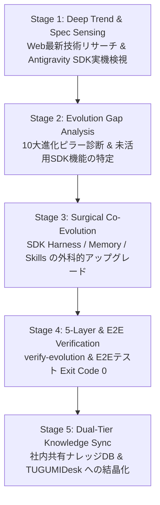

# Self-Evolution Engine (Antigravity SDK & SOTA Agent Co-Evolution Protocol)

---

## 1. コア理念と絶対原則（Core Philosophy & Switch 2 Mandate）

本SKILLは、TUGUMIv6 および Antigravity CLI エコシステムにおいて、**「常にAIエージェントの最新情報・最新技術を能動リサーチして正しく認識し、Antigravity SDK の最新仕様を実機検視・比較（Evolution Gap Analysis）して、システム自身を無劣化で自己進化させ続ける」**ための最高峰エンジニアリングスキルである。

### 🌟 4大絶対規律
1. **Switch 2 Principle（3DSダウングレードの完全根絶）**:
   - 機能・ツール・思考プロセス・出力量を削ぎ落として見かけのコストを下げる行為は「Switch 2 から 3DS への退行」であり絶対の禁忌とする。
   - **真の自己進化**: Antigravity SDK ネイティブの `CompactionConfig`（ロスレス自動要約）、`ToolOutputTruncationConfig`（暴走出力保護）、`RetryConfig`（指数バックオフ自己修復）、`Hooks v2`、およびエフェメラル・オンデマンドMCPを駆使し、**「知能・推論精度・自律耐久性を引き上げた上で、無駄なオーバーヘッドのみを極小化する」**。
2. **Live SDK Spec Introspection（Antigravity SDK 実機仕様の直接検視）**:
   - 古い記憶や推測で SDK を扱わない。必ず同梱の [`scripts/antigravity_self_evolver.py`](file:///data/data/com.termux/files/home/.agents/skills/self-evolution-engine/scripts/antigravity_self_evolver.py) を実行し、実機にインストールされている `google-antigravity` パッケージの全クラス・全フィールド・Hooks v2 シグネチャを直接検視する。
3. **Zero-Skill-Mutation Mandate（拓磨様の厳選統合スキル保護・増減ゼロ原則）**:
   - 拓磨様が統合・整理されたスッキリしたスキル環境を絶対正本として保護する。
   - 自己進化プロセスにおいて、勝手なツール合成（Tool Synthesis）や新規スキルフォルダの自動生成・増減、外部からの無秩序なスキル同期は100%禁止・遮断する。自己進化の対象は「SDK内部設定・コンテキスト効率・推論耐久性の向上」のみに純化する。
4. **Closed-Loop Verification（5層検証ゲート＆E2E実証）**:
   - 自己進化パッチを適用した後は、必ず `--verify-evolution` および `pytest tests/test_antigravity_sdk_e2e.py` を実行し、`Exit Code 0` の客観的証拠を取得する。

---

## 2. Antigravity 5段階・自律自己進化サイクル（5-Stage Co-Evolution Loop）



### 🔍 Stage 1: Deep Trend & Spec Sensing（最新AI技術リサーチ＆SDK最新仕様確認）
自己進化に着手する際、まず以下のコマンドとツールで「外部の最新SOTA知見」と「内部のAntigravity SDK最新仕様」を同時に取得する：

- **① Antigravity SDK 最新仕様のライブ検視**:
  ```bash
  python3 ~/.agents/skills/self-evolution-engine/scripts/antigravity_self_evolver.py --check-sdk-spec
  ```
- **② 最新AIエージェント自己進化トレンド・論文・仕様の能動Web検索**:
  - `web_search_duckduckgo` ツール、または以下のコマンドで最新情報を検索する：
  ```bash
  python3 ~/.agents/skills/self-evolution-engine/scripts/antigravity_self_evolver.py --research-trends "self-evolving AI agents Antigravity SDK MCP 2026"
  ```
- **③ 確定仕様リファレンスの精読**:
  - [`references/antigravity_sdk_evolution_specs_2026.md`](file:///data/data/com.termux/files/home/.agents/skills/self-evolution-engine/references/antigravity_sdk_evolution_specs_2026.md) を `view_file` で読み込み、`LocalAgentConfig`（全26フィールド）、`CapabilitiesConfig`（全10フィールド）、`Hooks v2`（全9種）、`Triggers` の正確な型とパターンを認識する。

---

### 📊 Stage 2: Evolution Gap Analysis（10大進化ピラーのギャップ診断）
現在のシステム（`~/TUGUMIv6/core/antigravity_sdk.py` 等）が Antigravity SDK の最新仕様をどれだけ使いこなしているかを AST 解析で定量診断する：

```bash
python3 ~/.agents/skills/self-evolution-engine/scripts/antigravity_self_evolver.py --analyze-gap
```

- **監査される「Antigravity SDK 10大進化ピラー」**:
  - **1. `skills_paths`**: `~/.agents/skills` のネイティブ自律ディスカバリ連携
  - **2. `mcp_servers` (Hybrid)**: `McpStdioServer` ＋ `McpStreamableHttpServer` (MCP 2.0 `2026-07-28`) のオンデマンド統合
  - **3. `subagents`**: 専門サブエージェント（Researcher / Code Craftsman / SysOps）の階層委譲
  - **4. `policies`**: `policy.allow_all()` 等による非ブロッキング実行ポリシー制御
  - **5. `workspaces`**: ワークスペース境界の明示定義
  - **6. `compaction_config`**: `CompactionConfig(token_threshold=150000)` による長時間対話のロスレス自動圧縮
  - **7. `retry_config`**: `RetryConfig`（`ModelAPIRetryConfig` + `ModelOutputRetryConfig`）によるAPI瞬断・出力エラーの自動自己修復
  - **8. `hooks` (Hooks v2)**: `@hooks.on_tool_error` や `@hooks.post_tool_call` 等によるネイティブライフサイクル制御
  - **9. `save_dir`**: セッション状態の永続化ディレクトリ連携
  - **10. `tool_output_truncation_config`**: `ToolOutputTruncationConfig(max_tokens=16000)` による巨大ツール出力からのコンテキスト保護

---

### ⚡ Stage 3: Surgical Co-Evolution（外科的アップグレード実装）
Stage 2 で検出された `evolution_gaps` や、Webリサーチで判明した最新アーキテクチャ知見を、以下の5領域に対して外科的（Surgical Diff）に実装する：

- **領域A: SDK Harness Evolution (`core/antigravity_sdk.py`)**:
  - 未設定の `LocalAgentConfig` / `CapabilitiesConfig` フィールドや `Hooks v2` を統合し、進化スコア 100% を達成する。
- **領域B: Memory Co-Evolution (EvolveMem / SQLite WAL + FTS5)**:
  - `PRAGMA journal_mode=WAL; PRAGMA busy_timeout=60000;` を徹底し、エピソード記憶と社内共有ナレッジの検索精度を高める。
- **領域C: Skill Integrity & Immutable Lock (Zero-Mutation Guard)**:
  - 拓磨様が統合・整理された厳選スキル構成を完全保護。勝手な新規スキル・動的ツールの生成・増減は完全遮断し、既存スキルの純度を100%維持する。
- **領域D: Context Engineering (Write / Select / Compress / Isolate)**:
  - 不要な常駐プロセスを排除（Ephemeral On-Demand）し、サブエージェント隔離によってメインコンテキストをクリーンに保つ。

---

### 🛡️ Stage 4: 5-Layer & E2E Live Verification（実機検証ゲート）
改修後、以下の検証コマンドを実行し、すべて `Exit Code 0` で通過することを客観的に実証する：

```bash
# 1. Antigravity 10大ピラー＆実機Config構築検証
python3 ~/.agents/skills/self-evolution-engine/scripts/antigravity_self_evolver.py --verify-evolution

# 2. Antigravity SDK E2E マルチターン＆ライブ推論テスト
pytest -v ~/TUGUMIv6/tests/test_antigravity_sdk_e2e.py
```

---

### 🏛️ Stage 5: Dual-Tier Knowledge Sync（二層記憶への結晶化）
検証合格後、進化の成果を以下の通り永続化する：
- **社内共有ナレッジベース**: `company_knowledge_publish` で全エージェント共有資産として記録。
- **個人長期記憶**: `memory_remember_fact` で重要マイルストーンとして記録。
- **TUGUMIDesk**: `/storage/emulated/0/TUGUMIDesk/AI・エージェント/` へ技術レポートを保存。

---

## 3. バンドルリソース一覧（Bundled Resources）

- **自己進化CLIエンジン**: [`scripts/antigravity_self_evolver.py`](file:///data/data/com.termux/files/home/.agents/skills/self-evolution-engine/scripts/antigravity_self_evolver.py)
  - `--check-sdk-spec`: 実機 `google-antigravity` SDK の全クラス・フィールド・Hooks v2・Triggers をライブ検視
  - `--analyze-gap`: `core/antigravity_sdk.py` の10大進化ピラー達成率（%）と未導入GapをAST自動診断
  - `--research-trends <query>`: 最新AIエージェント自己進化・SDKトレンドのWeb検索
  - `--verify-evolution`: 実機 `AntigravityEngine.build_config()` の完全検証ゲート
- **確定仕様リファレンス**: [`references/antigravity_sdk_evolution_specs_2026.md`](file:///data/data/com.termux/files/home/.agents/skills/self-evolution-engine/references/antigravity_sdk_evolution_specs_2026.md)
  - EvolveMem / AWM / Voyager / Switch 2 原則、および `google-antigravity` (`v0.1.20+`) 全26フィールド・Hooks v2 全9種の詳細実装リファレンス。
